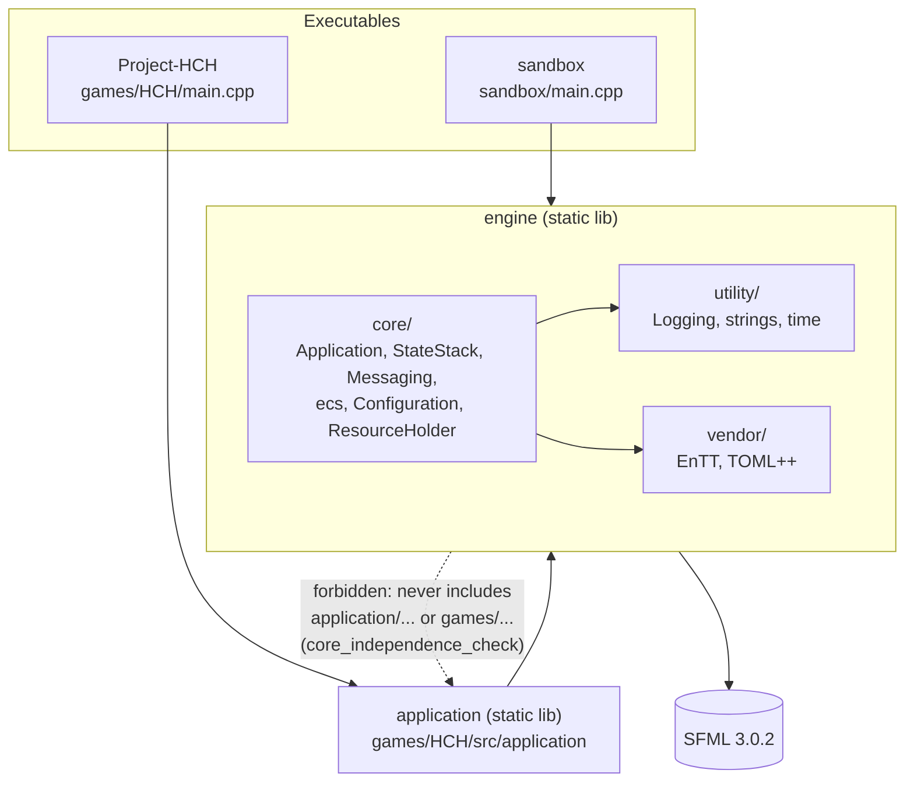
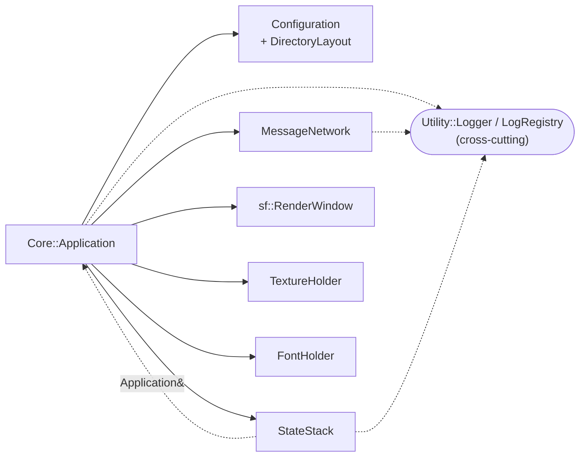
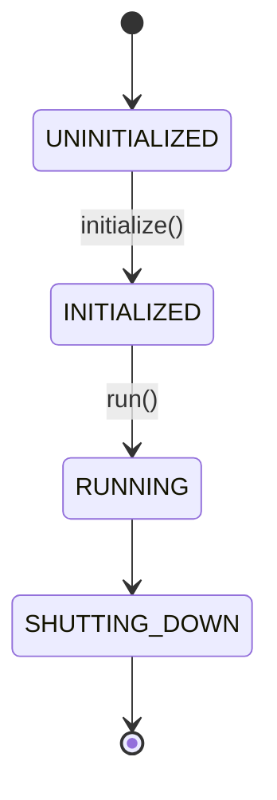
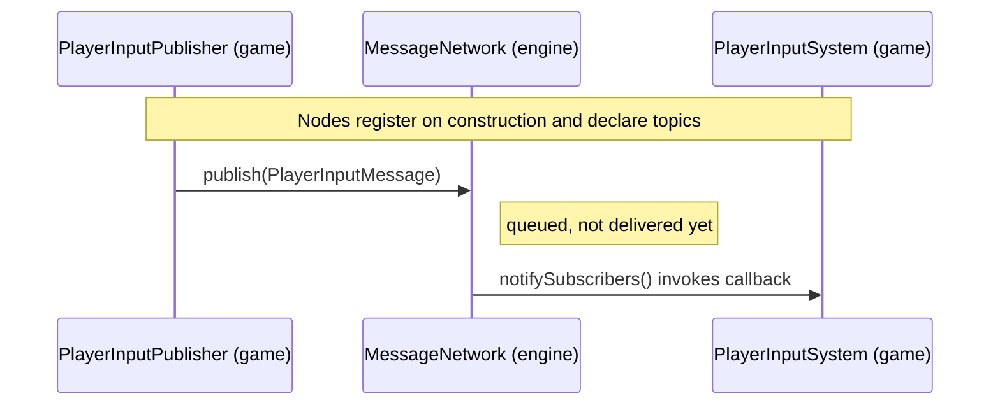
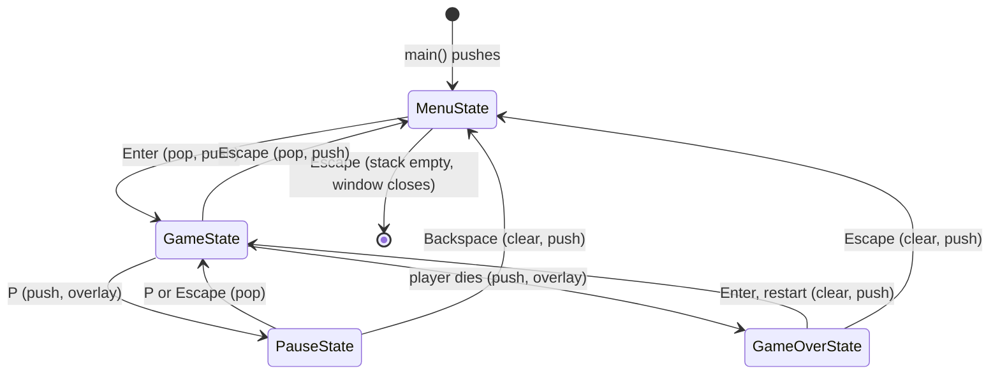
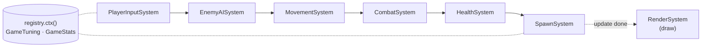
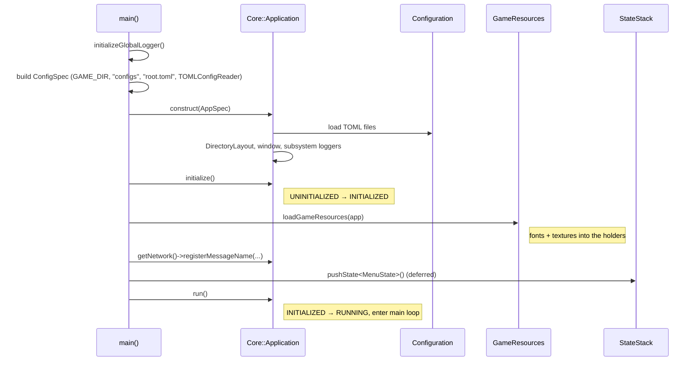
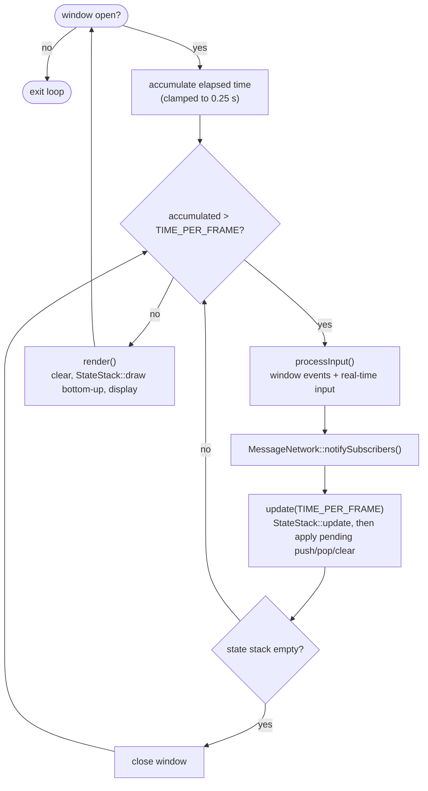

# Architecture

This document describes how Project HCH is organised: what each part of the repository is for, how the parts depend on one another, and how the program behaves at runtime. For build and run instructions see the [README](README.md).

## Contents

1. [Overview](#1-overview)
2. [Repository layout](#2-repository-layout)
3. [Layering and dependency rules](#3-layering-and-dependency-rules)
4. [Engine subsystems](#4-engine-subsystems)
5. [Game layer (HCH)](#5-game-layer-hch)
6. [Runtime flow](#6-runtime-flow)
7. [Configuration and assets](#7-configuration-and-assets)
8. [Build and test](#8-build-and-test)
9. [Extending the project](#9-extending-the-project)
10. [Further reading](#10-further-reading)

---

## 1. Overview

Project HCH is a C++20 game engine and the game built on top of it.

| Concern | Technology |
|---|---|
| Windowing, rendering, input | [SFML](https://www.sfml-dev.org/) 3.0.2 (fetched by CMake) |
| Entity Component System | [EnTT](https://github.com/skypjack/entt) (vendored, header-only) |
| Configuration files | [TOML++](https://github.com/marzer/tomlplusplus) (vendored, header-only) |
| Tests | GoogleTest (fetched by CMake) |
| Build | CMake 3.30+ with `CMakePresets.json` |

The repository produces four kinds of target:

- **`engine`**: a static library. It is game-agnostic and contains the application loop, state stack, messaging, configuration, ECS base classes and utilities.
- **`application`**: a static library holding the HCH game layer (states, scene, components, systems, game messages). It is built on `engine`.
- **`Project-HCH`**: the game executable. Its `main.cpp` wires the engine to the game layer.
- **`Sandbox`**: a minimal executable that links only `engine`. It is for trying engine features without any game code.

The engine is the product; the game proves it. That intent drives the central design rule in [section 3](#3-layering-and-dependency-rules).

## 2. Repository layout

```
Project-HCH/
├── CMakeLists.txt            Root build: fetches SFML + GoogleTest, adds the subdirectories below
├── CMakePresets.json         Configure/build presets (Linux Makefiles, Windows VS 2022/2025)
├── .clang-format             Formatting rules (see scripts/format.sh)
├── .github/workflows/ci.yml  CI: build + test on Windows, Linux and macOS
│
├── engine/                   Target: engine (static library)
│   ├── core/
│   │   ├── Application.*         Window, main loop, lifecycle state machine
│   │   ├── StateStack/           State base class and the stack that drives it
│   │   ├── Messaging/            Pub/sub: MessageNetwork, MessageNode, Message
│   │   ├── ecs/                  EntityManager, Entity, BaseSystem (wrap EnTT)
│   │   ├── Configuration/        Config loading, directory layout, logger setup
│   │   ├── GameAssetContainer/   ResourceHolder<T> (textures, fonts)
│   │   └── Exceptions/
│   ├── utility/              Logging, string operations, time, vector math
│   └── vendor/               EnTT, TOML++ (third-party, header-only)
│
├── games/HCH/                Target: application (library) + Project-HCH (executable)
│   ├── main.cpp              Composition root for the game
│   ├── configs/              root.toml, core_configurables.toml, gameplay.toml, prefabs.toml
│   ├── assets/               fonts/, textures/
│   └── src/application/      Game layer
│       ├── StateStack/           MenuState, GameState, PauseState, GameOverState
│       ├── Scene/                Scene + ECS (Components/, Systems/, EntityFactory, GameTuning)
│       ├── Messaging/            Message IDs, messages, publishers
│       ├── Data/                 Resource keys + loading, PlayerAction
│       ├── Settings/             KeyBindings
│       └── UI/                   Text helpers
│
├── sandbox/                  Target: sandbox (engine-only executable, own configs/ and assets/)
├── tests/                    GoogleTest binaries: Core/, Utility/, Application/
└── scripts/format.sh         Runs clang-format
```

**Include roots.** Engine headers are included relative to `engine/` (`"core/Application.hpp"`, `"utility/Logging/Logger.hpp"`). Game headers are included relative to `games/HCH/src` (`"application/Scene/Scene.hpp"`).

## 3. Layering and dependency rules



**The rule:** dependencies point from games toward the engine, never the other way. `engine/` must not `#include "application/..."` or `"games/..."`. The CTest `core_independence_check` (`tests/check_core_independence.cmake`) scans the engine and fails the build if this is violated.

Because the engine cannot name game types, it offers generic mechanisms and the game fills in the specifics:

| Concern | Engine provides | Game supplies |
|---|---|---|
| Message IDs | `Core::MessageID` (an integer alias; `0` means none) | The enum in `Messaging/MessageIds.hpp`, plus readable names via `Messages::registerMessageNames()` |
| Resource keys | `TextureHolder` / `FontHolder`, keyed by `std::string` | Key constants (e.g. `Fonts::ARIAL`) and file loading in `Data/GameResources.*` |
| States | `Core::State`, `Core::StateStack` (created from functor factories) | `MenuState`, `GameState`, `PauseState`, `GameOverState` |
| Root directory | `Core::ConfigSpec::rootDirectory` | The `GAME_DIR` compile definition on the game library (`SANDBOX_DIR` for the sandbox) |
| Gameplay data | Config sections and TOML reading | `gameplay.toml` and `GameTuning::fromConfig` |

## 4. Engine subsystems

### 4.1 Application

`Core::Application` is the engine's entry point. It is constructed from an `AppSpec` (window name and size, plus a `ConfigSpec`) and owns almost everything else:



Its lifecycle is a small state machine enforced by `requestTransition()`:



Any other transition is rejected. `pushState<T>()` is ignored while the application is still `UNINITIALIZED`.

### 4.2 StateStack

`Core::StateStack` holds a vector of `Core::State` objects. Typical use is layered screens: a pause menu on top of the game, for example.

- **Input and updates** (`handleKeyPressed`, `handleMouseMoved`, `handleRealTimeInput`, `update`) are delivered top-down. Each state's return value says whether the states below it should also receive the call; returning `false` stops propagation (an overlay such as `PauseState` freezes the game beneath it this way).
- **Drawing** is bottom-up, so lower states stay visible beneath overlays.
- **Transitions are deferred.** `pushState<T>()`, `popState()` and `clearStates()` only enqueue a `PendingStateRequest`; the queue is applied by `applyPendingChanges()` at the end of `StateStack::update()`. This avoids invalidating the stack while it is being iterated.
- **Creation uses functor factories.** A push stores a `std::function<std::unique_ptr<State>()>` created in a templated method, so the stack itself never includes game headers.

States request changes through `State::requestStackPush<T>()`, `requestStackPop()` and `requestStateClear()`, and reach the application through `getApplication()`.

### 4.3 Messaging

`Core::MessageNetwork` decouples producers from consumers. Classes derive from `Core::MessageNode` (`SUBSCRIBER`, `PUBLISHER` or `SUB_AND_PUB`), register with the network, and declare topics by `MessageID`.



Messages are queued by `publish()` and delivered when `notifySubscribers()` runs. The application calls it once per fixed update, right after input is processed. Publishers never know who consumes a message. `MessageNetwork` is owned by `Application`; nodes receive it by reference.

### 4.4 Entity Component System

The generic ECS infrastructure is in `engine/core/ecs/`:

- `EntityManager` wraps an `entt::registry`, owns the registered systems and runs them (`update`) and the rendering system (`render`).
- `Entity` is a thin wrapper over `entt::entity` with `addComponent<T>()`, `getComponent<T>()` and `removeComponent<T>()`.
- `BaseSystem` is the system interface: `virtual void update(sf::Time)` and `virtual void render()`.

The engine defines no components or concrete systems. Those belong to the game ([section 5](#5-game-layer-hch)).

### 4.5 Configuration

`Core::ConfigSpec` tells the engine where to look: root directory, config directory, root config file and a `ConfigReader` implementation (`TOMLConfigReader`). `Configuration` loads the files and exposes top-level tables as `ConfigSection` objects. `DirectoryLayout` resolves the asset, config and `output/` directories relative to the game root. `LoggerBuilder` builds loggers from configuration.

Subsystems ask for their own section by name (`Application`, `StateStack`, `MessageNetwork`, ...) and tolerate it being absent. For rationale and details see `engine/core/Configuration/DESIGN_CONFIGURATION.md`.

### 4.6 Resources

`ResourceHolder<T>` (in `GameAssetContainer/`) stores loaded assets under string keys. `Application` exposes a `TextureHolder` and a `FontHolder`. The engine only provides the container; keys and file paths are game decisions.

### 4.7 Logging

`Utility::Logger` is created with a builder and writes to pluggable sinks (`ColorConsoleSink`, `TextFileSink`) using interchangeable formatters (`DefaultFormatter`, `KeyValueFormatter`). `LogRegistry` is a global singleton for looking up named loggers, and `Application` builds a logger per subsystem. Logging calls are guarded by compile-time constants (`Utility::CAN_LOG`, `CAN_LOG_INFO`, ...), and the minimum level is set at configure time with `-DLOG_LEVEL=<NONE|DEBUG|INFO|WARN|ERROR>` (default: `DEBUG` in Debug, `WARN` in Release). For details see `engine/utility/Logging/DESIGN_LOGGER.md`.

## 5. Game layer (HCH)

The game layer lives in `games/HCH/src/application/` and builds into the `application` library.

### 5.1 States



`GameState` owns a `Scene` and a `PlayerInputPublisher`. When the player dies it records the final wave and score on `GameOverState` and pushes it on top.

### 5.2 Scene and systems

`Scene` owns an `EntityManager`, registers the game's systems, creates the player (via `EntityFactory`) and forwards `update` and `draw` to the manager. Shared per-run data lives in the registry context (`registry.ctx()`):

- `GameTuning`: gameplay balance values, loaded from `configs/gameplay.toml` through `GameTuning::fromConfig`.
- `GameStats`: wave, score, time until the next wave, and whether the player is dead.

Systems run in a fixed order each update, then the rendering system draws:



Order matters: input is read first, and spawning runs last, so newly spawned entities first act on the next update.

Components (`Scene/ECS/Components/`): `Transform`, `Velocity`, `Collider`, `Health`, `Team`, `Shape`, `MeleeAttacker`, `Hitbox`, `EnemyAI` and `PlayerInputComponent`, plus `Player` and `Enemy` tag components.

### 5.3 Game messaging

`Messaging/MessageIds.hpp` defines the game's `Messages::ID` enum (`PlayerActionMessage`, `EnemySpawnMessage`) and `registerMessageNames()`. `PlayerInputPublisher` translates SFML input (through `Settings/KeyBindings` and `Data/PlayerAction`) into `PlayerInputMessage`s, which `PlayerInputSystem` consumes.

## 6. Runtime flow

### 6.1 Startup



`ConfigurationException` and other `std::exception`s are caught in `main()`, printed to `stderr`, and the process exits with `-1`.

### 6.2 Main loop

`Application::run()` uses a fixed time step with an accumulator, so game logic is independent of frame rate. Each real-time delta is clamped to 0.25 s so that a stall (window drag, breakpoint) cannot cause a spiral of catch-up updates.



The application exits when the window closes or when the state stack becomes empty.

## 7. Configuration and assets

Each game (and the sandbox) has its own root directory containing `configs/`, `assets/` and, at runtime, `output/`:

| Path | Purpose |
|---|---|
| `games/HCH/configs/root.toml` | Entry file read by `Configuration` |
| `games/HCH/configs/core_configurables.toml` | Settings for engine subsystems (sections such as `Application`, `StateStack`, `MessageNetwork`) |
| `games/HCH/configs/gameplay.toml` | Gameplay tuning, read by `GameTuning::fromConfig` |
| `games/HCH/configs/prefabs.toml` | Reserved for entity definitions (currently a placeholder) |
| `games/HCH/assets/` | `fonts/` and `textures/` |
| `output/` | Per-run output such as log files (created at runtime, git-ignored) |

The root directory is passed in from the game (`ConfigSpec::rootDirectory`, set from `GAME_DIR`), so the engine never hard-codes a path.

## 8. Build and test

- **Targets:** `engine` → `application` → `Project-HCH`, plus `sandbox` and one executable per test file. The game library and engine compile with `-Wall -Wextra -Wpedantic` on GCC/Clang (`/W4` on MSVC).
- **Tests:** every `.cc` file under `tests/Core/`, `tests/Utility/` and `tests/Application/` is compiled into its own GoogleTest binary linked against `engine` and `application`, and registered with CTest (5 s timeout each). `core_independence_check` is registered alongside them.
- **CI:** `.github/workflows/ci.yml` uses the CMake presets to build in Release on Windows (`windows-VS22`, `windows-VS25`), Linux (GCC) and macOS (`release-unix_makefiles`), then runs all test binaries with `ctest --preset`. A separate `Format Check` job runs `scripts/format.sh --check` with clang-format 18.
- **Formatting:** use `scripts/format.sh`; `.clang-format` defines the style.

```bash
cmake --preset debug-unix_makefiles
cmake --build --preset debug-unix_makefiles
ctest --test-dir ./build --output-on-failure
```

## 9. Extending the project

| To add... | Do this |
|---|---|
| **A game state** | Derive from `Core::State` in `games/HCH/src/application/StateStack/`, add the files to `GAME_LIB_SRC`/`GAME_LIB_INC` in `games/HCH/CMakeLists.txt`, and push it with `requestStackPush<T>()` from another state. |
| **A component or system** | Add the component to `Scene/ECS/Components/`; derive the system from `Core::BaseSystem` in `Scene/ECS/Systems/`; register it in `Scene::initializeGameSystems()` at the correct position in the order. |
| **A message** | Add an ID to `Messages::ID` and a name in `registerMessageNames()`; create `Message` and publisher/subscriber classes deriving from `MessageNode`. |
| **A tunable value** | Add it to `gameplay.toml` and read it in `GameTuning::fromConfig`. |
| **A texture or font** | Drop the file in `games/HCH/assets/`, add a key constant, and load it in `Data/GameResources.cpp`. |
| **A new game** | Create `games/<Name>/` with its own `CMakeLists.txt`, `configs/`, `assets/` and `main.cpp`; link it to `engine`; and add it to the root `CMakeLists.txt`. The sandbox is the smallest example. |
| **A test** | Add a `.cc` file to the matching `tests/` subdirectory. It is picked up automatically on the next CMake configure. |

When adding engine code, keep it free of game types. If the engine needs something game-specific, add a generic hook (a callback, an alias or a config value) and let the game supply it.

## 10. Further reading

- [README](README.md): requirements, build and run instructions
- [`engine/core/Configuration/DESIGN_CONFIGURATION.md`](engine/core/Configuration/DESIGN_CONFIGURATION.md): configuration design
- [`engine/utility/Logging/DESIGN_LOGGER.md`](engine/utility/Logging/DESIGN_LOGGER.md): logging design
- [Project wiki](https://github.com/H-Matthews/Project-HCH/wiki)
